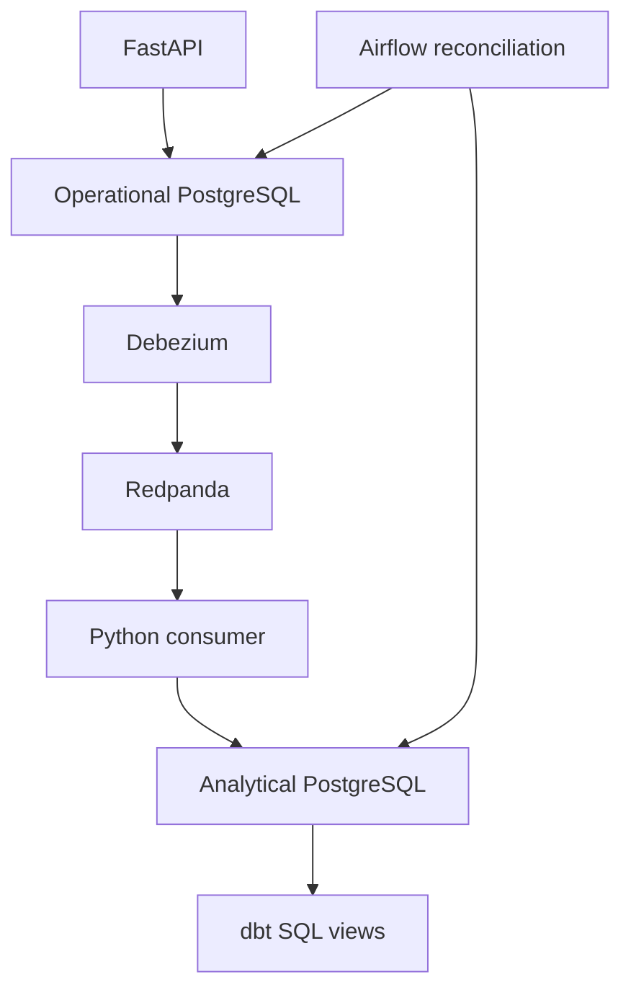

# Banking Data Integration & Streaming Platform

A fictional bank streams committed PostgreSQL transaction changes into analytical PostgreSQL. FastAPI generates source activity, Debezium tails the WAL, Redpanda transports keyed events, and a Python consumer materializes versioned state. dbt exposes SQL analytics. Optional Airflow workflows reconcile the replica and repair missing active rows.



## Run locally

```bash
cp .env.example .env
docker compose up --build -d --wait --wait-timeout 300
docker compose run --rm tools python -m banking.generate create --count 120
docker compose run --rm tools python -m banking.generate mutate --count 120
docker compose run --rm tools python -m banking.verify state
docker compose run --rm dbt build
docker compose run --rm tools python -m banking.verify aggregates
```

Use a fresh stack or a new seed for each create scenario. The [runbook](docs/RUNBOOK.md) covers Windows/WSL, service inspection, replay, failure drills, and shutdown.

## Design and verification

- At-least-once consumption with transactional receipts and version-guarded target writes. PostgreSQL commits before Kafka offsets advance.
- Amounts use integer minor units. Aggregates group by currency and use the current payment status and UTC creation date.
- [Architecture](docs/ARCHITECTURE.md) · [Setup](docs/SETUP.md) · [CDC and Kafka](docs/CDC_KAFKA.md) · [dbt](docs/DBT.md) · [Airflow](docs/AIRFLOW.md)
- [Testing](docs/TESTING.md) · [Troubleshooting](docs/TROUBLESHOOTING.md) · [Costs](docs/COSTS.md) · [Evidence](docs/EVIDENCE.md)
